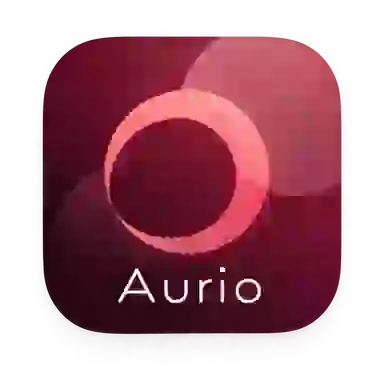
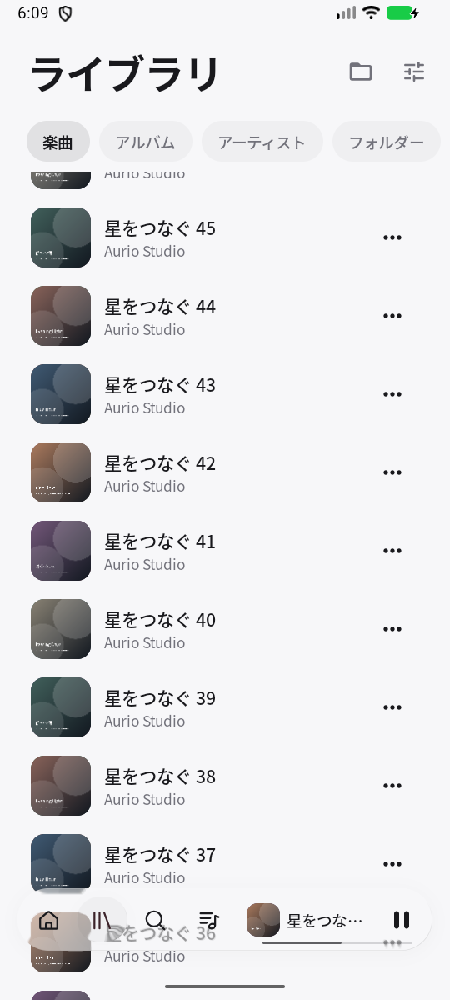
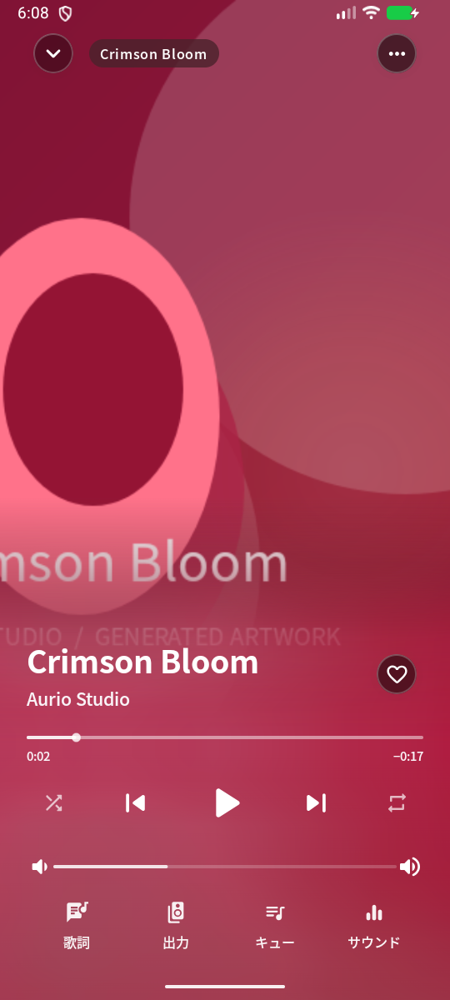
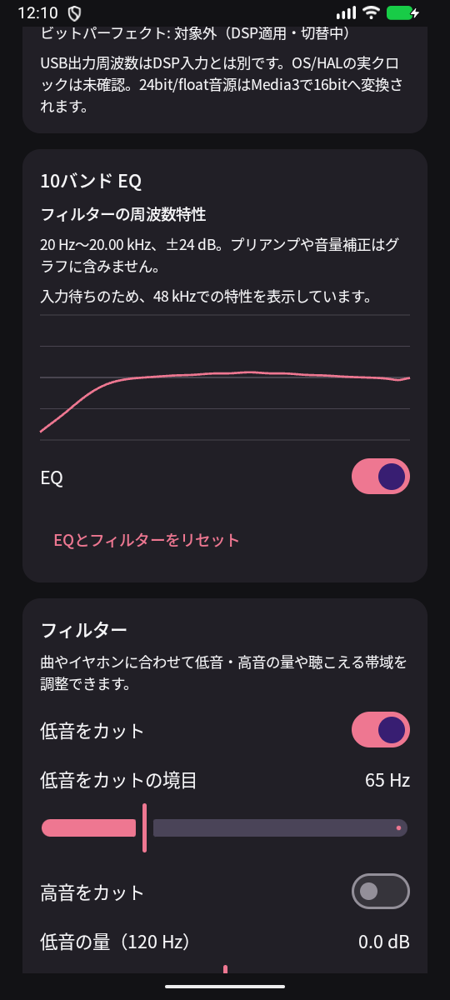

<div align="center">



# Aurio

Aurioは端末に保存した曲を聴くためのAndroid向け音楽プレイヤーです。曲を整理し、再生記録を振り返りながら、10バンドEQとフィルターで音を調整できます。

[v1.6.0 APKをダウンロード](https://github.com/noppy3325-droid/Aurio/releases/download/v1.6.0/Aurio-1.6.0.apk) · [リリース一覧](https://github.com/noppy3325-droid/Aurio/releases) · [使い始める](#使い始める)

Android 10以上 · オフライン再生 · オープンソース

</div>

## 画面

| ライブラリ | 再生画面 | サウンド |
|:---:|:---:|:---:|
|  |  |  |

*画面の楽曲名とアートワークはテスト用に生成したものです。*

## できること

- **音楽を整理する** — フォルダーを追加して、曲・アルバム・アーティストを閲覧できます。検索、お気に入り、プレイリストにも対応しています。
- **聴いた曲を振り返る** — ホームでは再生記録などに基づくおすすめを表示します。「再生記録」では合計時間と曲別ランキングを見られます。ランキングは再生回数順と再生時間順に切り替えられます。
- **ジャケットと一緒に楽しむ** — 再生画面にはジャケットの色が広がります。ミニプレイヤーの左右スワイプで曲を送り、上にスワイプすると再生画面を開けます。
- **シャッフルを楽しむ** — ライブラリの「楽曲」で、並べ替えの隣にあるシャッフルアイコンを3秒長押しすると、ランダムに選んだ曲から再生します。キュー内の曲を一巡に一度ずつ再生し、停止から6時間以上経過して再開すると曲順を作り直します。
- **音を調整する** — 10バンドEQと4種類のフィルターで低音や高音を調整し、好みの設定を保存できます。音量均一化、ステレオ幅、Directとの聴き比べにも対応しています。
- **出力先を選ぶ** — 本体スピーカーや接続中のBluetooth、USBオーディオ機器を選べます。再生中の画面で実際の出力先も確認できます。
- **見た目を変える** — ライト・ダーク表示、ガラスの描画品質、4色のアプリアイコンを設定できます。

歌詞、リピート、バックグラウンド再生、通知やイヤホンからの再生操作にも対応しています。

## 使い始める

1. 上のダウンロードリンクからAPKを取得し、Android端末にインストールします。
2. アプリを開き、音楽の入ったフォルダーを選びます。
3. ライブラリから曲を選んで再生します。フォルダーは設定から追加できます。

リリースAPKは開発用の署名鍵で署名されています。同じ署名の既存版には上書きインストールできます。

### アプリ内で更新を確認する

v1.6.0の「設定」にある「ソフトウェアアップデート」から、公開された最新版を確認できます。自動確認は設定で有効にできます。ダウンロードしたAPKの内容と署名を照合し、Androidの確認画面で承認すると更新できます。更新機能がない版からは、APKを手動で上書きしてください。

配布用APKと `update.json` の作成・検証手順は [リリース手順](docs/RELEASE-CONNECT.md) にあります。

### 再生記録

ホーム右上の「再生記録」から、合計再生時間、再生回数、聴いた曲数、曲別ランキング、再生履歴を確認できます。再生記録は端末内に保存され、画面右上の「消去」から削除できます。おすすめにもこの記録を使用します。

一定時間聴いた再生が集計の対象です。過去に再生時間が記録されていない曲は、時間が未記録として表示される場合があります。

### 音声出力

再生画面の「出力」、または設定の「音声出力」から出力先を選べます。実際の切り替えはAndroidと接続機器に依存します。再生中は選択した機器と実際の出力先を確認できます。

USBオーディオでは対応する形式がある場合にミキサーの設定を試みます。機器の仕様やビットパーフェクト再生は確認できた情報を表示します。24 bit・float音源は現在の共通再生経路でPCM 16 bitに変換されます。詳しくは[音声設計](docs/audio-dsp-v020.md)をご覧ください。

### サウンドの調整

再生画面の「サウンド」からEnhanceを選ぶと、10バンドEQに加えて低音・高音のカットや量を調整できます。グラフはEQとフィルターの効果を表示します。気に入った設定はプリセットに保存できます。

同じくらいの音量で比較したい場合は「聴き比べの音量」でEnhanceを調整し、Directと切り替えます。DirectではAurioの音声補正をバイパスします。v1.6.0の計測結果と実機試験が残っている項目は[検証記録](docs/VERIFICATION-v1.6.0.md)をご覧ください。

## 開発する

Kotlin、Jetpack Compose、Media3を使用しています。

- JDK 17以上
- Android SDK Platform 37
- Android SDK Build Tools 36.0.0

Android SDKの場所を `local.properties` に設定し、プロジェクトのルートで実行します。

```sh
./gradlew :core:test :app:testDebugUnitTest :app:assembleDebug :app:lintDebug
```

Windowsでは `./gradlew` の代わりに `gradlew.bat` を使います。デバッグAPKは `app/build/outputs/apk/debug/` に出力されます。`assembleRelease` は署名前のAPKを生成します。

横置きスタンバイのv1.8.0での変更内容は[検証記録](docs/VERIFICATION-v1.8.0.md)をご覧ください。

描画とタブ操作の検証は[1.1.0の検証記録](docs/VERIFICATION-v1.1.0.md)、描画とシャッフルの検証は[1.0.0の検証記録](docs/VERIFICATION-v1.0.0.md)をご覧ください。

## ライセンス

Aurioのソースコードは[MIT License](LICENSE)で公開しています。同梱フォントとライブラリにはそれぞれのライセンスが適用されます。詳しくは[サードパーティ表記](THIRD_PARTY_NOTICES.md)をご覧ください。
