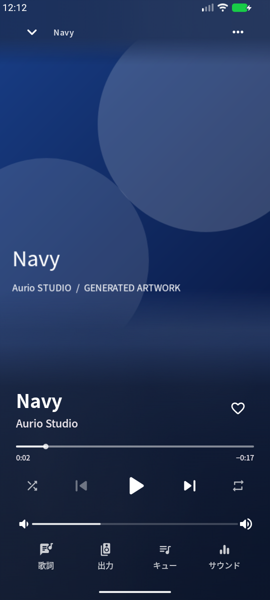
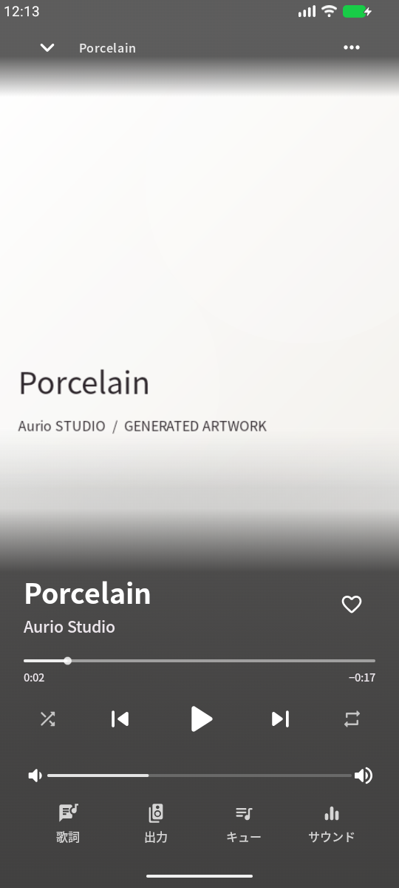
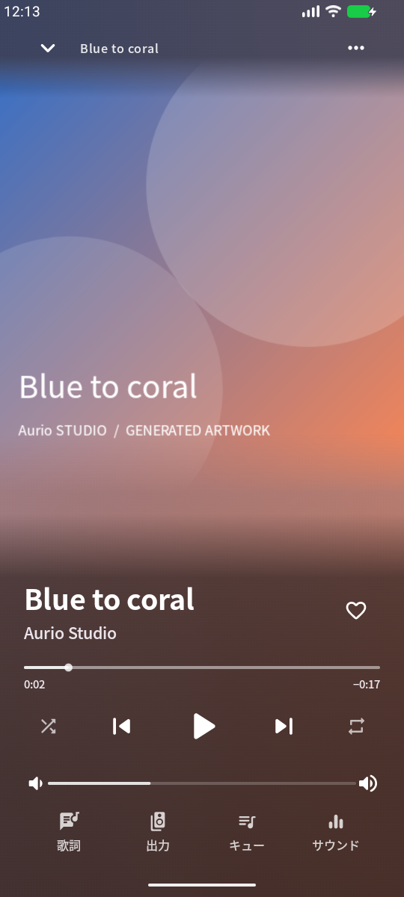

# Aurio v0.24 検証記録

## 確認した変更

| 対象 | 主な実装 |
| --- | --- |
| 選択レンズ | `LumaGlassControls.kt` でタブの実測位置を使って指に追随。離した後はページの進捗を使い、ページとレンズを同じ着地点へ動かす。 |
| ガラス描画 | `LiquidBackdrop.kt` で背後をサンプリングし、ぼかし、屈折、縁の光を描画。ガラスをオフにした場合と再生画面がバーを覆った場合は、下の画面のガラス用レイヤーの記録を省く。 |
| 再生画面 | `PlayerArtworkBackdrop.kt` と `ArtworkAmbientPalette.kt` で小さく縮めた画像から色を抽出し、背景とジャケットを一緒に切り替える。 |
| 再生履歴とホーム | `ListeningSession.kt`、`PlaybackHistoryStore.kt`、`HomeRecommendations.kt` で再生時間を計測し、Roomの集計をおすすめに利用する。旧履歴の日時は保持し、再生時間や完走は更新後のデータから記録する。 |

## 画面

Android 17 エミュレーターで撮影しました。楽曲名とアートワークは検証用です。

| 青 | 白 | 上下の色が異なる画像 |
| :---: | :---: | :---: |
|  |  |  |

[アートワーク全8パターン](screenshots/v024) · [ホームでレンズを直接ドラッグ](screenshots/v024/rev2-direct-drag.png) · [本文をスワイプ](screenshots/v024/rev2-body-swipe.png) · [ガラスの比較画面](screenshots/v024/rev2-glass-lab.png)

## 操作と描画の再現

1. 本文を左へ少しずつドラッグします。右隣のページが入り、選択レンズは右へ移動します。
2. 選択レンズの中心から右へ引きます。レンズが指に追随し、十分に引いて離すと右隣に移ります。短い移動で離すと元の位置へ戻ります。
3. ミニプレイヤーで左右にスワイプし、曲送りがタブ切替にならないことを確認します。
4. デバッグAPKで次のコマンドを実行します。模様をスクロールしながら「効果なし」「半透明」「レンズ」を切り替えます。ガラス品質を切り替えて同じ操作を繰り返します。

```sh
adb shell am force-stop jp.noppy.lumamusic
adb shell am start -n jp.noppy.lumamusic/.MainActivity --ez luma.glassDemo true
adb shell dumpsys gfxinfo jp.noppy.lumamusic reset
# 上記の操作を行ってから同じ端末・表示設定で比較する
adb shell dumpsys gfxinfo jp.noppy.lumamusic
```

ガラス品質を「軽量」にすると屈折を省きます。API 31–32はぼかし、API 33以降は対応する端末設定で屈折も描画します。API 29–30と品質「オフ」は静的表示になります。

## 推薦の固定データ

有効再生が60回で最終再生が20日前の曲と、45回で昨日の曲は、どちらも「よく聴く曲」の候補です。前者は「久しぶりに聴きたい曲」にも入ります。3回未満の曲は頻出・再発見枠から外れます。選曲テストは、履歴の量、日付境界、選曲の偏り、ファイルが利用できない場合を確認します。

端末がファイルの移動後も同じ文書IDを返す場合は再生統計を引き継ぎます。移動で文書IDが変わる提供元では別の曲として扱われます。

## 性能面の実装

- アートワークの色抽出とおすすめの並べ替えはメインスレッドの外で行います。ジャケット由来の背景は縮小画像をキャッシュし、再生位置だけの更新で再解析しません。
- おすすめに出す曲の読み取り可否は必要な候補から確認して短時間キャッシュします。ユーザーがタッチやスクロールをしている間、棚の並び替えを保留します。
- 選択レンズはタブごとの背景を切り替えず、ひとつの描画レイヤーを移動します。ガラスをオフにすると、効果に必要な背後の描画記録を省きます。

## テスト結果

- JVMのユニットテスト53件、デバッグ・リリースビルド、Android Lintが通過しました。
- エミュレーターの一括実行は18件中17件通過しました。音質モードのテスト1件が再生前のMediaSession接続でタイムアウトしました。署名済みの最終APKで音質モードとレンズ操作を再実行し、2件とも通過しました。
- 一括実行ではRoom移行、バックグラウンド再生の集計、検索・曲送り・シーク・キュー、横置き、ガラス品質の切り替えと回転を確認しました。

## ガラス描画の計測

署名済みAPKをAndroid 17エミュレーター（540 × 1200）で動かし、ビルド完了後にガラス検証画面を上下に12回スクロールしました。`dumpsys gfxinfo` の値です。

| 品質 | フレーム数 | 中央値 | 95パーセンタイル | ジャンク |
| --- | ---: | ---: | ---: | ---: |
| バランス | 166 | 18 ms | 32 ms | 31 / 166（18.67%） |
| オフ | 166 | 17 ms | 32 ms | 30 / 166（18.07%） |

この環境では安定した60 fpsを確認できていません。更新前はエミュレーターのSystem UIが停止し、同条件の比較データを取得できませんでした。実機での描画・起動時間、USB-C出力と接続機器のボタン操作は未計測です。

おすすめ候補の表示回数を記録するクールダウンは今回の集計対象から外しています。
