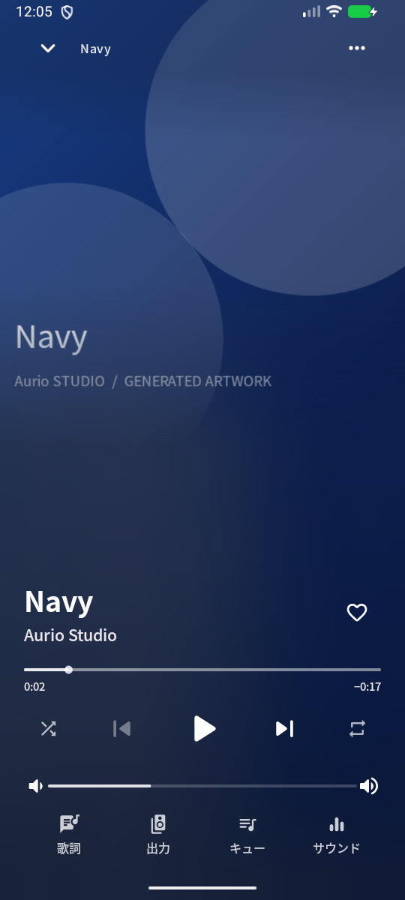
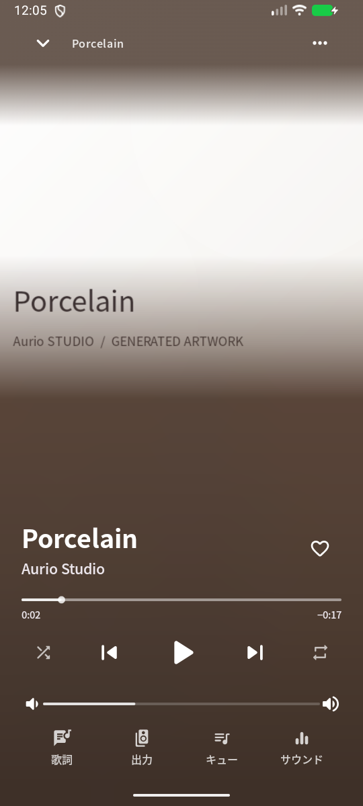
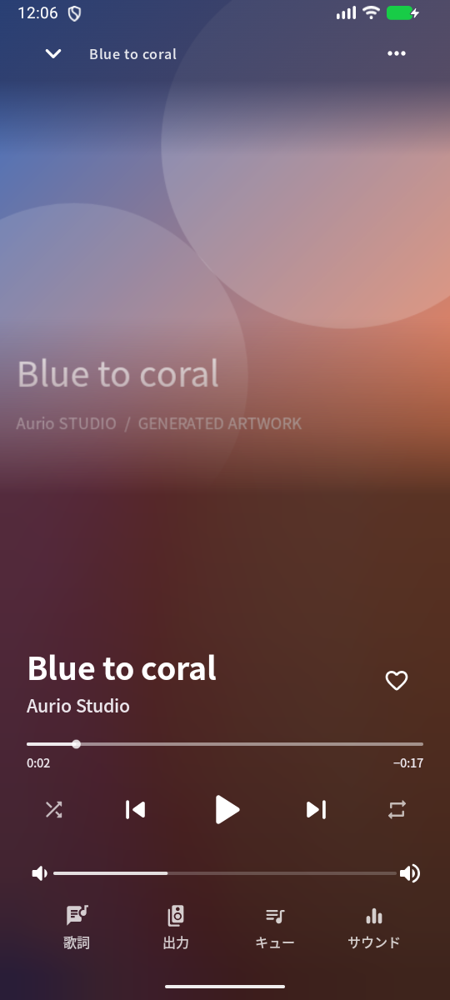

# Aurio v0.26の画面と操作

約28秒の参考動画を0.5秒間隔で確認しました。Aurioの既存UIを使って、ガラスの動きとジャケットのつながりを調整しています。

| 参考動画の動き | Aurioでの操作 |
| --- | --- |
| 冒頭のスクロールで下部の操作が一列になる | 曲を選び、ホームかライブラリの一覧を上へ送ると、ナビの横にミニプレイヤーが入ります。逆向きにスクロールすると二段に戻ります。 |
| タブを移ると選択ガラスがふくらむ | タブをタップするか、選択ガラスを隣へ引きます。指を離すとタブの位置に戻ります。 |
| 12〜14秒付近で小さいジャケットが全画面へ移る | ミニプレイヤーをタップするか上へ引くと、その位置からジャケットが広がります。閉じるとミニプレイヤーへ戻ります。 |
| 全画面でジャケットがステータスバーから操作部へ続く | 画像を画面上端から描き、下の操作部には同じ画像を縮小して作った色分布を使います。 |

横幅が足りない画面や文字を大きくしている環境では二段のドックを使います。一列の状態でも、ミニプレイヤーの左右スワイプで曲を送れます。

## 再生画面の例

Android 17エミュレーターで撮影しました。曲とジャケットは検証用です。

| 青いジャケット | 白いジャケット | 上下で色が違うジャケット |
| :---: | :---: | :---: |
|  |  |  |

[ナビとミニプレイヤーが一列になった状態](screenshots/v026/v054-compact-dock.png) · [ジャケットが広がる途中](screenshots/v026/v054-compact-artwork-morph.png)

## 確認結果

- 署名済みAPKでエミュレーターのテスト6件が通過しました。タブの切り替え、ドックの縮退と復帰、一列表示からの再生画面の開閉、8種類のジャケットと曲切り替え、44.1 kHzと48 kHzの再生を確認しました。
- 文字サイズ1.6倍でタブラベルを表示しました。長いラベルは横に省略され、上下は収まっています。
- ユニットテスト57件とリリースビルドが通過しました。Android Lintはエラー0件でした。
- 実機でのフレームレートとUSB-C音声は未確認です。
