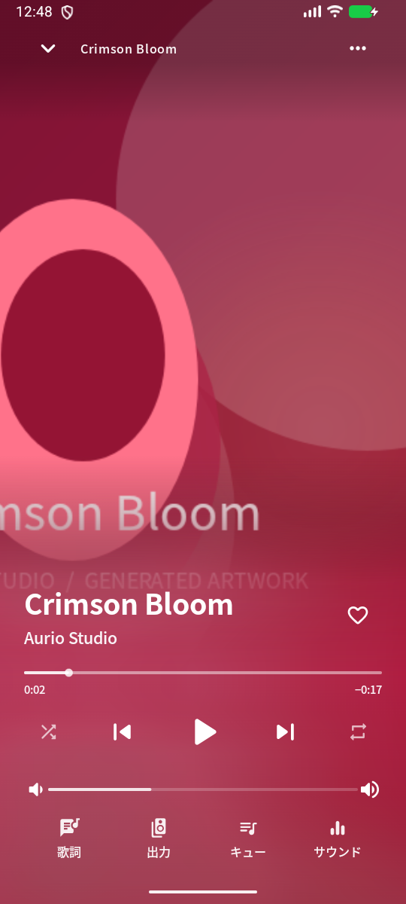
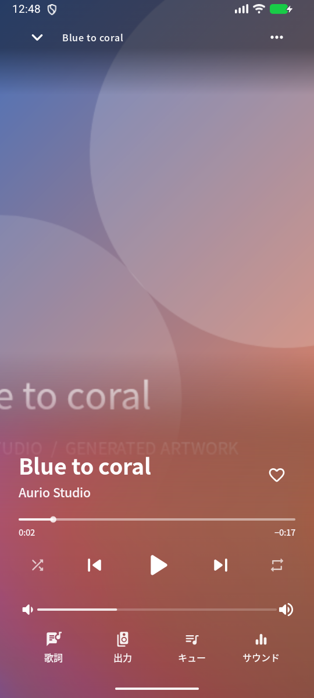
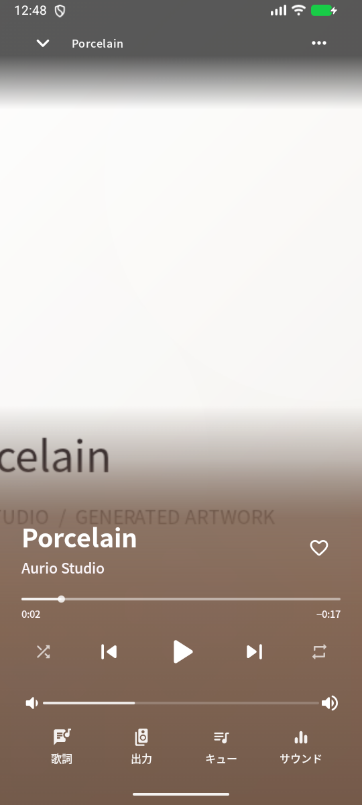
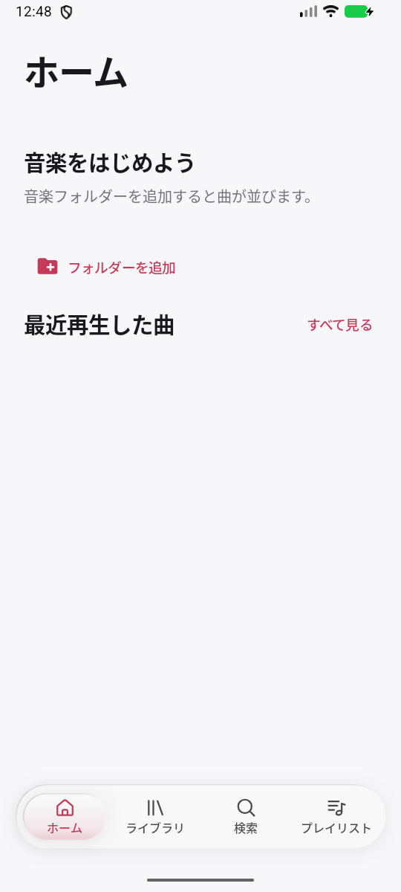
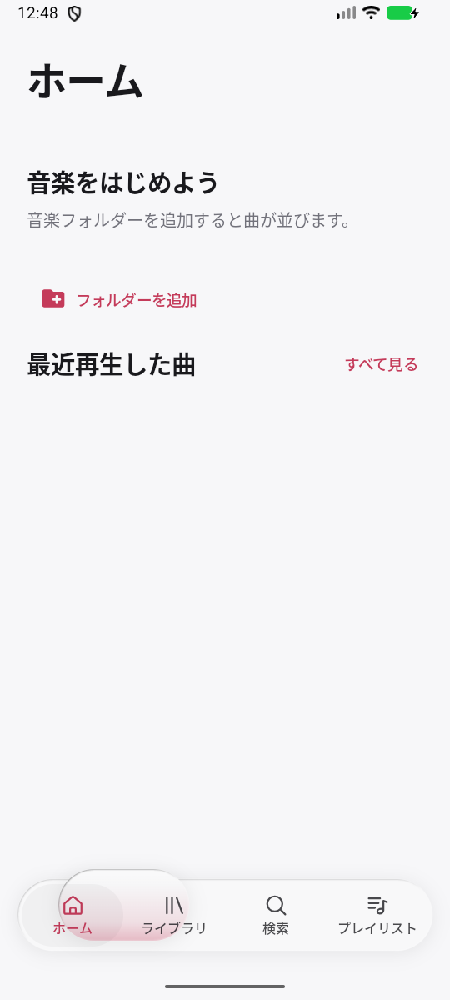
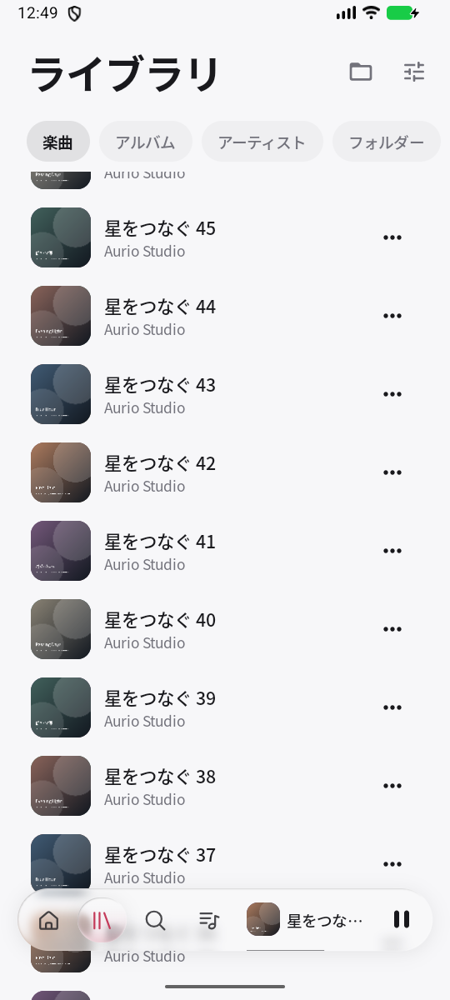

# Aurio v0.27の画面と操作

下の画像は配布用APKをAndroid 17エミュレーターで動かして撮影しました。曲名とジャケットは検証用です。

## 再生画面

ジャケットを画面上端から曲名のそばまで表示します。ジャケットと同じ位置から色を拾うため、左と右の色の違いが操作部にも残ります。縦長の画面で表示幅を埋めると、画像の左右が一部切れることがあります。

| 赤いジャケット | 上が青で下が暖色のジャケット | 白いジャケット |
| :---: | :---: | :---: |
|  |  |  |

## 下部メニュー

選択中のレンズを隣のタブへドラッグすると、レンズが上に浮いて広がります。ライブラリをスクロールすると、ミニプレイヤーとタブが一列に収まります。

背後の模様を曲げる屈折は、Android 13以降でガラスの品質を「高品質」か「バランス」に設定したときに有効です。省電力モードや動きを減らす設定では演出を抑えます。

| 静止時 | ドラッグ中 | ライブラリでの一列表示 |
| :---: | :---: | :---: |
|  |  |  |

[ランチャーアイコン](screenshots/v027/launcher-adaptive.png) · [テーマ連動の単色アイコン](screenshots/v027/launcher-monochrome.png)

## テスト結果

- 署名済みAPKをv0.26から上書きインストールし、エミュレーターで7件のテストが通過しました。タブのドラッグ、ジャケット9パターンと曲切り替え、再生画面とキュー、44.1 kHz・48 kHzの再生、ランチャーアイコンを確認しました。
- ユニットテスト58件とリリースビルドが通過しました。Android Lintはエラー0件でした。
- 実機での描画速度とUSB-C音声出力は未確認です。
