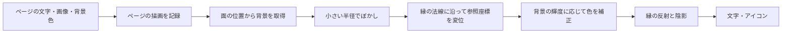
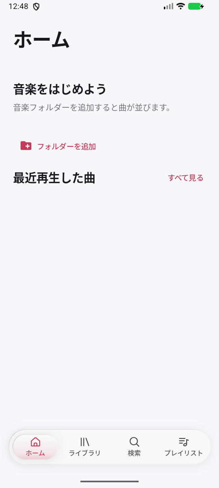
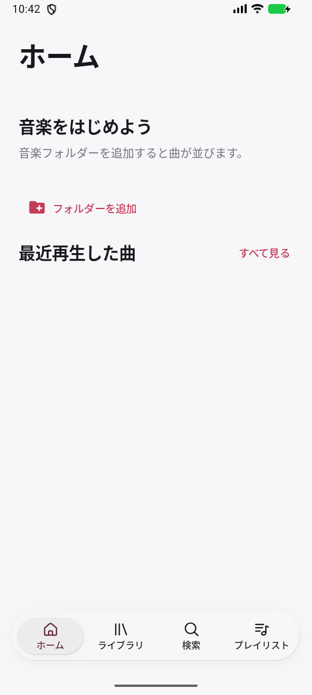
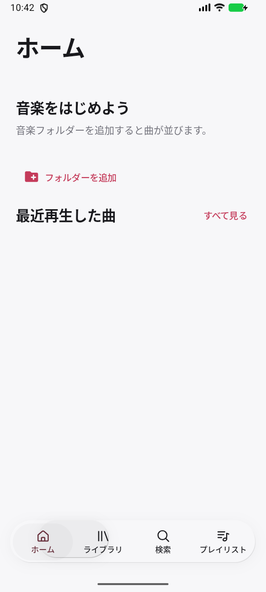
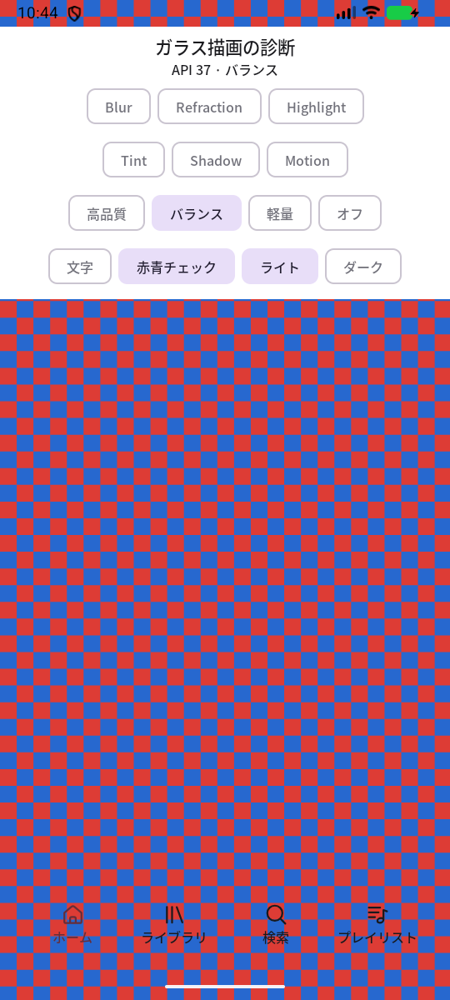
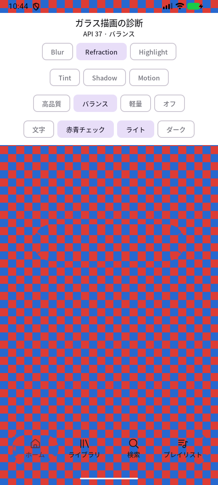
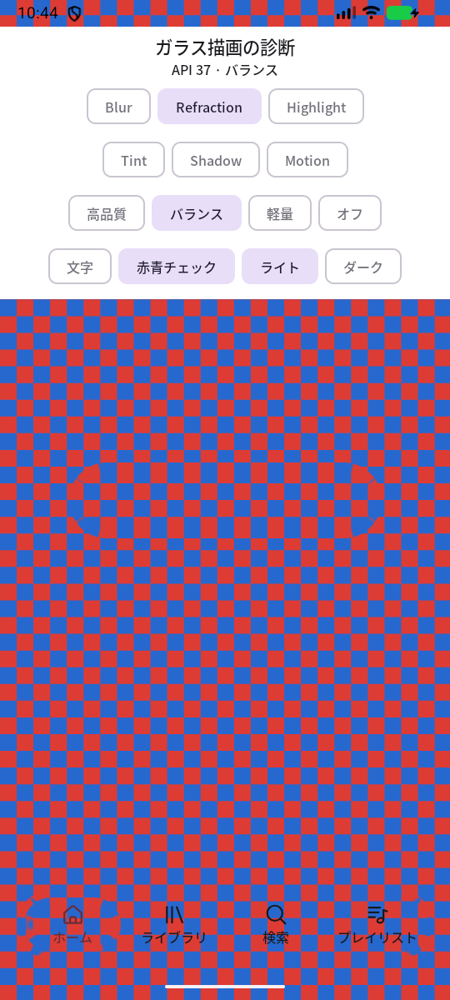

# Aurio 1.0.0のガラス描画とシャッフル再生

## v0.27の描画で確認した原因

- `LumaScreen` はテーマ背景とページを記録し、その上にドックを描いていました。ナビと選択レンズはページの同じ記録を参照していました。
- 旧 `LiquidBackdrop` は背景のコントラストを一律に調整し、ナビでは8〜12 dpのぼかしを使っていました。選択レンズはそのあと上側に白、下側にテーマのアクセント色を重ねるため、背景にピンクがない場面でもピンクが目立っていました。
- 旧 `PlaybackDock` は一列に変わる途中で、ナビ、ミニプレイヤー、一列のガラス面を同時に描いていました。それぞれが背景に効果をかけるため、一時的に処理が増え、ガラスが重なって見えました。

## 1.0.0の描画順

ナビ、ミニプレイヤー、選択レンズは同じページを参照します。選択レンズの描画元にほかのガラスやアイコンは含まれません。ドックは一列に収まったところでガラス面を切り替えます。接地影はガラス面の下に描きます。

| ファイル | 変更内容 |
| --- | --- |
| `GlassOptics.kt` | 角丸の輪郭からの距離で背景を曲げ、輝度に合わせて同じシェーダーで透過色と縁の反射を調整します。 |
| `LiquidBackdrop.kt` | 元のページの取得とガラス処理を共通化し、描画品質と端末設定に応じて効果を切り替えます。 |
| `LumaGlassControls.kt`、`GlassDock.kt` | 押下とドラッグに合わせてレンズが変形します。ナビとミニプレイヤーの曲率をそろえ、統合時にガラス面が重なる時間をなくしました。 |
| `GlassDiagnosticsScreen.kt`、`GlassSpikeTest.kt` | ぼかし、屈折、反射、色補正、影、動きを個別に切り替えます。文字または赤青の模様を背景に使います。 |

Android 13以降の「高品質」と「バランス」で屈折を使います。「軽量」、省電力、アプリのアニメーション軽減、Android 12では屈折を省きます。Android 10〜11、高コントラスト設定（Android 14以降）、「オフ」では通常パネルを表示します。

## シャッフルのサイクル

未再生の曲を一巡すると、新しいサイクルを用意します。リピートがオフの場合は一巡で止まり、次に再生を押したときに新しいサイクルを始めます。全曲リピートの場合は一巡後も続けて再生します。一時停止などで再生が止まってから6時間以上経っている場合と、シャッフルをオフからオンにした場合も、次に聴く順番を作り直します。一時停止中の曲は保存された位置から再開します。

再生サービスは曲順、サイクル内で聴いた曲、停止時刻を再生位置と一緒に保存します。バックグラウンドで聴いている間は停止時間に数えません。再生中にプロセスが終了した場合は、直前に保存できた再生情報から復元します。曲順はMedia3に反映されるので、再生キューや通知からも同じ順番で操作できます。

## 画面の比較

Android 17エミュレーターで、正式版と同じ描画処理の公開前候補を撮影しました。ライブラリの曲とジャケットは検証用です。参考映像とも並べ、静止時の輪郭、ドラッグ中の移動、背景のスクロール、一列表示を見比べました。

| 修正前の下部メニュー | 修正後の下部メニュー | 修正後のドラッグ中 |
| :---: | :---: | :---: |
|  |  |  |

| 効果なし | 屈折だけ | 屈折だけでスクロール後 |
| :---: | :---: | :---: |
|  |  |  |

[白地の文字とガラス](screenshots/v100/diagnostic-light.png) · [ダーク表示の診断画面](screenshots/v100/diagnostic-dark.png) · [曲一覧のスクロール](screenshots/v100/library-scroll.png) · [ミニプレイヤーとタブの一列表示](screenshots/v100/compact-dock.png) · [ダークテーマのライブラリ](screenshots/v100/library-dark.png)

[タブ移動とライブラリの画面録画](screenshots/v100/glass-motion.mp4)

## 検証結果

- 診断画面で屈折以外を切り、チェック柄の境界がレンズ内で動くことと、レンズ外の比較領域がほぼ変化しないことを画素で確認しました。スクロール後にもレンズの背景が更新されました。ぼかし、反射、色補正、影も個別に切り替え、比較画像でそれぞれの画素の変化を確認しました。
- 通常の画面で本体スワイプ、レンズのドラッグ、ミニプレイヤーの曲送り、再生画面の開閉を確認しました。端末の高コントラスト設定では通常パネルに切り替わりました。
- ユニットテスト66件とエミュレーターのテスト18件が通過しました。Android Lintはエラー0件でした。6時間ちょうどでのリセット、既存のシャッフル履歴の復元、一巡時の曲順、再生位置、音声処理、ライブラリの回帰を確認しました。
- 同じエミュレーターでタブを8回切り替えた計測では、描画期限を外したフレームの割合はv0.27で20.6%、今回の公開前候補で4.0%でした。各版1回の実測値です。
- 実機での60 fps、USB-C出力、メーカー固有の通知表示、Android 12以前での見た目は未確認です。

## 参照資料とライセンス

公開資料から、操作面の分離、背景の屈折、静止時と操作中の差を確認しました。 [材質のガイド](https://developer.apple.com/design/human-interface-guidelines/materials) · [光学と動きの解説](https://developer.apple.com/videos/play/wwdc2025/219/)

参考アプリは、ページを記録し、ナビとミニプレイヤーへガラス材質を渡します。浮いたレンズは処理済みのバーとタブ表示も読んでいます。Aurioのレンズは元のページを直接読みます。参考アプリはGPL-3.0で、コードや画像をAurioに取り込んでいません。描画基盤のBackdrop 2.0.1はApache-2.0です。 [参考アプリの描画](https://github.com/kushagrasinghx/BitChord/blob/acf219a7e4a7f52f026d4336d5c7ac5cf7bfafcc/app/src/main/java/com/music/bitchord/ui/components/floatingtabbar/FloatingTabBar.kt#L578-L610) · [Backdrop 2.0.1](https://github.com/Kyant0/AndroidLiquidGlass/tree/2.0.1) · [ライセンス表記](../THIRD_PARTY_NOTICES.md)
