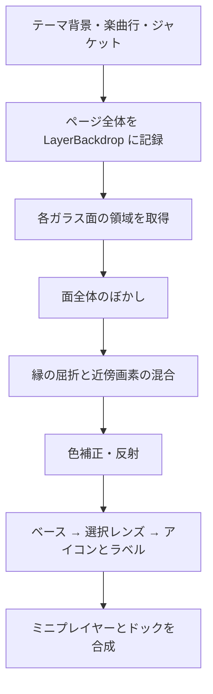
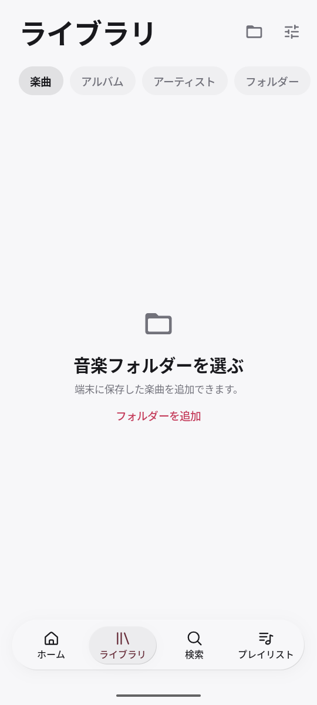
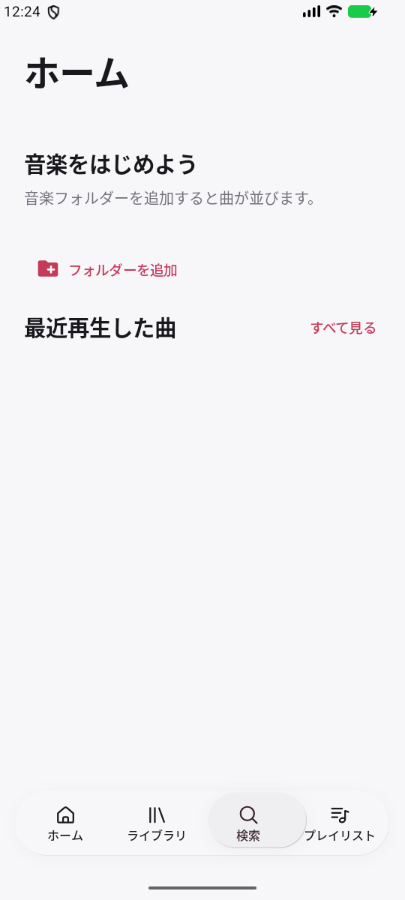
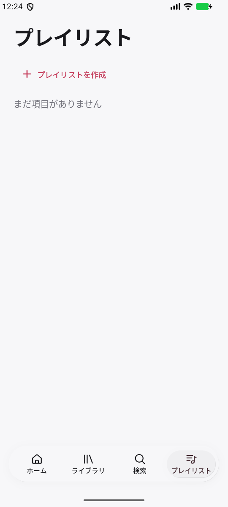
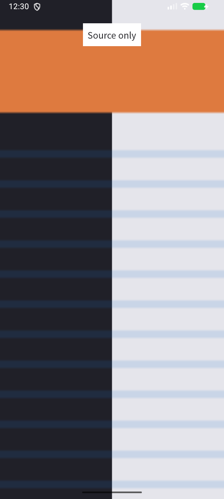
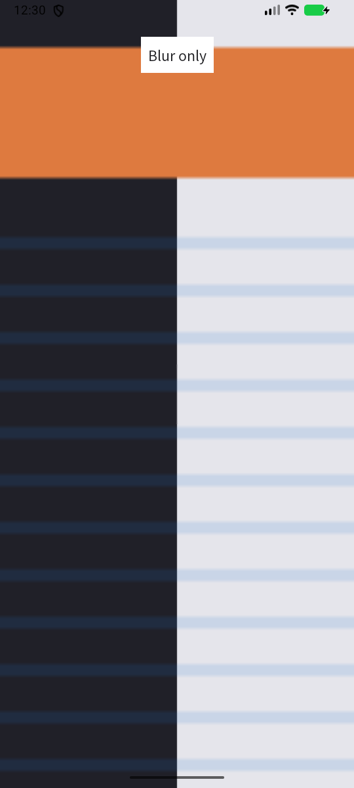
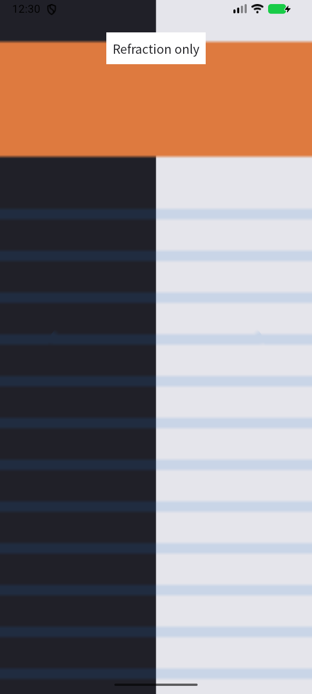
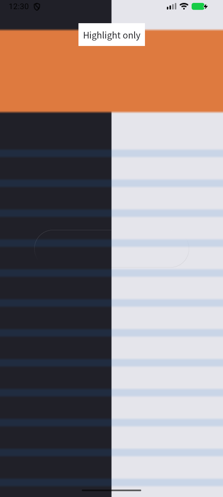
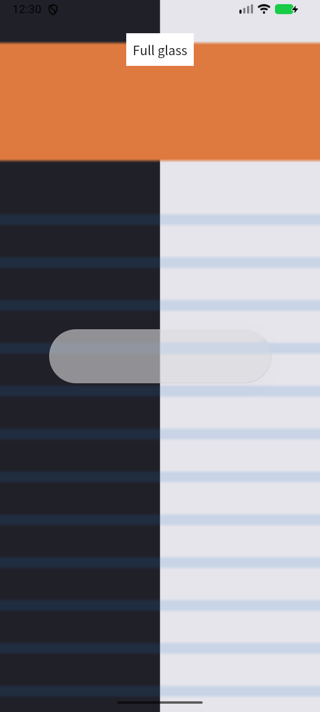

# Aurio 1.1.0のガラス描画とタブ操作

## 変更前の描画順

1.0.0では、`LumaScreen` がテーマ色を含むページを `LiquidBackdropHost` に渡していました。Backdropはページの表示領域と同じ大きさのGraphicsLayerを保持し、ページの描画が更新されたときに記録します。ガラスは各面の座標に合わせてその記録を読みます。前のフレームをビットマップとして残す処理や、前景のアイコンを背景へ戻す処理はありませんでした。 [1.0.0のページ描画](https://github.com/noppy3325-droid/Aurio/blob/v1.0.0/app/src/main/java/jp/noppy/lumamusic/ui/LumaScreen.kt#L154-L206) · [Backdropの記録処理](https://github.com/Kyant0/AndroidLiquidGlass/blob/65ab177e90e5c1d8c62e70cf7755841982da65f6/backdrop/src/commonMain/kotlin/com/kyant/backdrop/backdrops/LayerBackdropModifier.kt#L51-L59)

## 原因と対応

提供動画は約18.6秒です。序盤と中盤のライブラリで、下にある曲名がミニプレイヤーやナビの中で白っぽい塊に見えます。検索のように背後の要素が少ない画面では、にじみが目立ちません。描画原因とドラッグの制限はソースで確認しました。

| 症状 | 1.0.0で確認した原因 | 変更 |
| --- | --- | --- |
| 曲名が白くにじむ | `LiquidBackdrop.kt:123–142` で面全体をぼかし、`GlassOptics.kt:66–86` でも近傍画素を混ぜ、暗い画素を同じ明るさに寄せていた | 元の背景を主に使う1回のシェーダー処理へ変更。縁で座標を曲げ、暗い画素にも明るさの差を残す |
| レンズが隣で止まる | `LumaGlassControls.kt:275–285` は隣の中心間に移動を制限し、`:356–361` は移動先を開始位置の±1に制限していた | すべてのタブの実測中心を補間し、指を離した位置と速度で移動先を一度だけ決める |
| 本文のフリックが一段ずつになる | `LumaScreen.kt:99` は `PagerDefaults.flingBehavior` の標準の移動範囲を使っていた。修正中の試験でも、フリック開始時に `settledPage` が近い側のページへ更新されるため、移動距離が実際より短くなることが分かった | ページャーがスナップ計算に渡すページを基準に距離を測り、進捗に合わせてレンズを動かす |
| アイコンや色が重なって見える | `GlassDock.kt:83–101` と `LumaGlassControls.kt:215–244` を調べた結果、ベースとレンズは同じ元ページを別々に参照し、アイコンは最前面にあった | 循環するキャプチャを避ける描画順を維持。ミニプレイヤーとナビが一列に収まると、共有のガラス面を描く |

## 1.1.0の実装

`GlassOptics.kt` と `LiquidBackdrop.kt` では、Android 13以降の通常描画を1回のシェーダー処理にまとめています。ガラス中央では背景の元の位置を主に読み、縁に近づくほど曲率に沿って参照位置を変えます。反射もレンズの縁に合わせ、文字とアイコンはその後に描画します。「軽量」では屈折を省いたぼかしを使い、「オフ」または高コントラスト設定では通常パネルを使います。

`LensAnchors.kt` と `LumaGlassControls.kt` では、指の位置を実測のタブ中心から連続したタブ座標に変換します。ドラッグ中に変わるのはレンズの位置と見た目です。指を離すと `LumaScreen.kt` のページャーに移動を1回伝え、レンズはそこで着地します。本文ではページ幅の45％以上を移動し、速度が毎秒2.4ページ以上の場合に限って、隣より先へのフリックを許可します。通常のページャーに移動距離を渡し、本文とレンズの位置を同じページ進捗から更新します。

開発ビルドの `GlassDiagnosticsActivity` で、Source only、Blur only、Refraction only、Highlight only、Full glassを切り替えられます。「サンプル範囲」を有効にすると、背景の記録範囲、各ガラス面の参照範囲と更新状況が表示されます。

## 画面と録画

撮影環境はAndroid 17エミュレーター（540 × 1200、214 dpi）です。下のライブラリに表示される曲名とジャケットは検証用です。録画中は操作位置が分かるようにAndroidのタップ表示を有効にしています。

| 1.0.0で右端までドラッグした結果 | 1.1.0で検索を通過中 | 1.1.0で指を離した結果 |
| :---: | :---: | :---: |
|  |  |  |

| Source only | Blur only | Refraction only | Highlight only | Full glass |
| :---: | :---: | :---: | :---: | :---: |
|  |  |  |  |  |

[一筆ドラッグの録画](screenshots/v110/one-drag.mp4) · [ライブラリのスクロール録画](screenshots/v110/library-motion.mp4) · [範囲と更新情報の表示](screenshots/v110/diagnostic-overlay.png) · [スクロール中のライブラリ](screenshots/v110/library-scroll.png) · [ミニプレイヤーとの一列表示](screenshots/v110/compact-dock.png) · [ダークテーマ](screenshots/v110/library-dark.png) · [暗い面の屈折と色補正](screenshots/v110/full-glass-dark.png) · [スクロール後の屈折](screenshots/v110/refraction-after-scroll.png)

## 参照した実装

参考アプリはページを記録し、ナビの加工済みガラスとタブ列も選択レンズの素材に入れています。タブ列では連続位置を使い、ドラッグから着地まで素材の状態を更新します。Aurioでは元ページをベースとレンズが直接参照し、前景の文字とアイコンを最後に描きます。参考アプリのGPL-3.0のコードや画像は取り込んでいません。 [ページ記録](https://github.com/kushagrasinghx/BitChord/blob/acf219a7e4a7f52f026d4336d5c7ac5cf7bfafcc/app/src/main/java/com/music/bitchord/MainActivity.kt#L421-L441) · [ガラスの構成](https://github.com/kushagrasinghx/BitChord/blob/acf219a7e4a7f52f026d4336d5c7ac5cf7bfafcc/app/src/main/java/com/music/bitchord/ui/components/LiquidGlass.kt#L215-L264) · [ドック](https://github.com/kushagrasinghx/BitChord/blob/acf219a7e4a7f52f026d4336d5c7ac5cf7bfafcc/app/src/main/java/com/music/bitchord/ui/components/GlassNavBar.kt#L123-L202) · [選択レンズとタブ列](https://github.com/kushagrasinghx/BitChord/blob/acf219a7e4a7f52f026d4336d5c7ac5cf7bfafcc/app/src/main/java/com/music/bitchord/ui/components/floatingtabbar/FloatingTabBar.kt#L525-L610)

描画基盤は既存のApache-2.0のBackdrop 2.0.1を使います。上流のサンプルでは、タブの位置とレンズの動きを別に扱い、位置に応じた背景を参照します。本文のフリックはCompose Pagerの公開APIを使います。 [Backdropのタブの例](https://github.com/Kyant0/AndroidLiquidGlass/blob/kmp/app/src/commonMain/kotlin/com/kyant/backdrop/catalog/components/LiquidBottomTabs.kt) · [Compose Pager](https://developer.android.com/develop/ui/compose/layouts/pager) · [ライセンス表記](../THIRD_PARTY_NOTICES.md)

## ビルドと配布APKの検査

単体テスト69件が通過しました。Android Lintはエラー0件、警告26件、ヒント1件でした。配布APKのバージョンは1.1.0（versionCode 29）で、既存版と同じ署名を確認しています。ガラス診断の画面と起動先は開発APKのDEXとマニフェストで確認しました。配布APKには含まれていません。

## アプリアイコンの確認

設定で選べる4色をAndroidのランチャーから取得し、丸型のアイコンとして描画しました。各色でランチャーに表示する入口が1つあり、リングのまわりに余白が残ることを確認しました。設定画面からサファイアに切り替え、外から開き直しても選択が保たれました。ローズに戻す操作も設定画面の中で完了しました。 [4色のアイコンと実装](aurio-icon.md)

## 画面操作と描画の確認

ドックをホームからプレイリストまで一度でドラッグし、逆方向に戻す操作を確認しました。検索を横切っても画面が切り替わらないこと、指を戻した場合や操作をキャンセルした場合は元のタブに戻ることも確認しました。本文では短いフリック、隣への通常スワイプ、2タブ以上移動する左右のフリックを確認しました。

ジャケットを実際にデコードして背景に描き、格子の輪郭がレンズの縁でずれることを画素で確認しました。スクロール後にサンプルが更新されること、ガラスの外側と軽量モードでは屈折による位置のずれが出ないことも検査しました。ライブラリの縦スクロール、検索、ミニプレイヤーの曲送り、再生画面、歌詞、画面回転とスタンバイは操作テストに含めています。

最終の署名済みAPKでエミュレーターの全19項目が通過しました。シャッフルの曲送り、44.1 kHz・48 kHzの再生、ライブラリの移行と走査、4色のアイコン切り替えを含みます。

## 描画時間の参考値

Android 17エミュレーターで同じ順にタブを8回切り替え、`dumpsys gfxinfo` を各版で1回取りました。ホストPCの負荷やエミュレーターの再起動も影響するため、実機のフレーム時間や改修単独の効果を示す測定ではありません。

| バージョン | 記録フレーム | 描画期限を超えたフレーム | 中央値 | 90パーセンタイル |
| --- | ---: | ---: | ---: | ---: |
| 1.0.0 | 162 | 138（85.19%） | 44 ms | 150 ms |
| 1.1.0 | 293 | 69（23.55%） | 34 ms | 73 ms |

## 実機での確認が残る項目

Xiaomi 14Tでのフレーム時間、タブ移動時の振動、USBオーディオ機器の接続と取り外し、端末固有のメディア表示は実機確認が残っています。掲載した画面と操作の記録はエミュレーターで取得しました。
